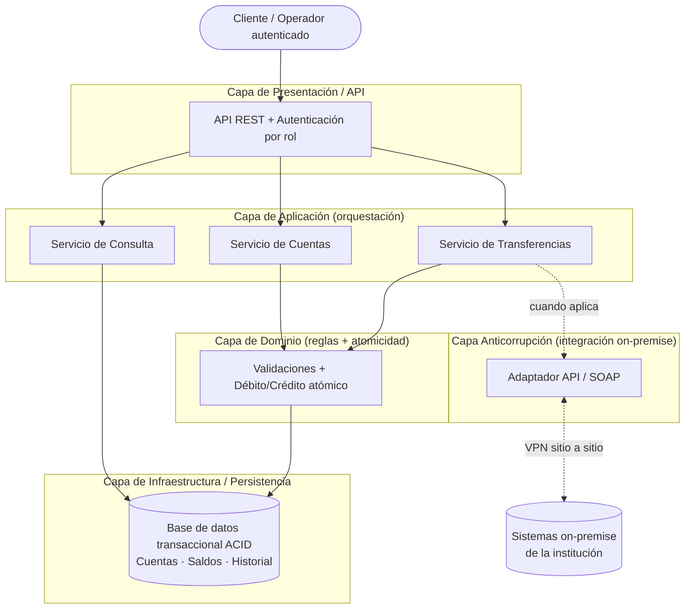
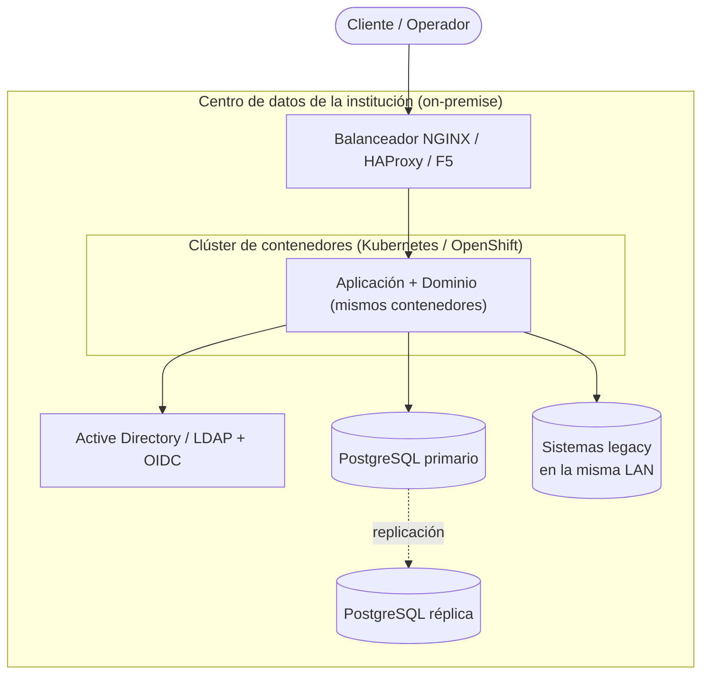

# Decisión Arquitectónica

> **Responsable:** Fabiola
> **Tarea:** T-04
> **Estado:** ✅ Completado
> **Depende de:** T-01

---

## 1. Contexto y fuerzas que guían la decisión

La institución requiere un sistema de transferencias confiable cuyo atributo de calidad dominante es la **consistencia financiera**: ninguna operación puede crear ni destruir dinero. A esto se suman la confiabilidad ante fallos, la trazabilidad de cada operación, la seguridad por rol y la mantenibilidad de las reglas de negocio.

Condiciones de despliegue que acotan la decisión:

- El sistema se desplegará en **AWS** (nube), no on-premise.
- La integración con sistemas internos de la institución (on-premise) se realizará mediante **VPN sitio a sitio** y servicios **API REST / SOAP**.
- La primera fase cubre creación de cuentas, validación y procesamiento de transferencias, registro y consulta de historial; no contempla integración con bancos externos ni pasarelas de terceros.

---

## 2. Estilo arquitectónico seleccionado

**Arquitectura en Capas con un núcleo de dominio transaccional**, desplegada como aplicación modular contenedizada en AWS, e integrada con los sistemas on-premise a través de una **capa anticorrupción** (Anti-Corruption Layer).

El principio rector es: **la operación de transferencia (débito + crédito) ocurre como una sola transacción ACID dentro de un único almacén de datos transaccional**, evitando la consistencia distribuida.

---

## 3. Justificación

| Requerimiento no funcional | Cómo lo satisface la arquitectura elegida |
|----------------------------|-------------------------------------------|
| **Consistencia (RNF-01)** | El débito y el crédito se ejecutan en una transacción ACID única sobre una base de datos relacional gestionada. Si algo falla, se revierte todo (*rollback*), cumpliendo la regla de atomicidad (RB-07). No hay transacciones repartidas entre servicios. |
| **Confiabilidad (RNF-02)** | El resultado de toda operación queda determinado (`COMPLETADA`/`RECHAZADA`) y persistido antes de responder. La idempotencia por referencia única (RB-05) permite reintentos seguros ante cortes de red o VPN. |
| **Seguridad (RNF-03)** | La autenticación y autorización por rol se concentran en la capa de presentación/aplicación, apoyadas en servicios de identidad gestionados. |
| **Integridad y trazabilidad (RNF-04)** | El registro de transacciones vive en la capa de infraestructura con referencia única y estado consultable. |
| **Mantenibilidad (RNF-07)** | Las reglas de validación se aíslan en la capa de dominio; cambiarlas no obliga a tocar presentación, persistencia ni integraciones. La capa anticorrupción aísla el núcleo de los detalles de SOAP/VPN. |

---

## 4. Descripción de las capas

| Capa / Módulo | Responsabilidad | Componentes del sistema |
|---------------|-----------------|-------------------------|
| **Presentación / API** | Exponer la API a los clientes, autenticar y autorizar. | API pública REST, control de acceso por rol. |
| **Aplicación (orquestación)** | Coordinar cada caso de uso, abrir y cerrar la transacción, controlar la idempotencia. | Servicio de transferencias, servicio de cuentas, servicio de consulta. |
| **Dominio (reglas de negocio)** | Ejecutar validaciones y la operación atómica débito/crédito. Es el corazón del sistema. | Validaciones, lógica de débito/crédito, invariantes financieros. |
| **Infraestructura / persistencia** | Guardar cuentas, saldos e historial con garantías ACID. | Repositorio de cuentas, repositorio de historial. |
| **Integración (capa anticorrupción)** | Traducir entre el dominio y los sistemas on-premise vía VPN + API/SOAP, sin contaminar el núcleo. | Adaptador de integración on-premise. |

> La capa de dominio no conoce AWS, ni SOAP, ni la VPN: solo reglas de negocio. Esa independencia es la que sostiene la mantenibilidad (RNF-07).

---

## 5. Diagrama de capas

> **Versiones editables (draw.io):** diagrama de capas en `diagrama-capas.drawio` y diagrama de despliegue en AWS con iconos oficiales en `diagrama-aws.drawio`.

---

## 6. Mapeo a servicios de AWS

| Capa lógica | Servicio AWS propuesto | Justificación |
|-------------|------------------------|---------------|
| Presentación / API | **API Gateway** + **Application Load Balancer** | Punto de entrada gestionado, con control de tráfico y TLS. |
| Identidad y acceso | **Amazon Cognito** + **IAM** | Autenticación de usuarios y autorización por rol (RNF-03). |
| Aplicación y dominio | **Amazon ECS (Fargate)** | Contenedores sin gestión de servidores; la lógica de dominio corre aquí. |
| Persistencia | **Amazon RDS / Aurora PostgreSQL** | Transacciones ACID nativas que garantizan atomicidad débito/crédito (RNF-01). |
| Idempotencia / reintentos | **Tabla de referencias de solicitud** en RDS | Soporta RB-05 (procesamiento único) ante reintentos por cortes de VPN. |
| Integración on-premise | **AWS Site-to-Site VPN** + adaptador API/SOAP | Canal cifrado hacia los sistemas internos de la institución. |
| Observabilidad y auditoría | **Amazon CloudWatch** + **AWS CloudTrail** | Trazabilidad operativa y de accesos (apoya RNF-04). |

> La elección de una base de datos **relacional transaccional** (RDS/Aurora) sobre una NoSQL es deliberada: el invariante financiero exige transacciones ACID multi-registro, que las bases relacionales ofrecen de forma nativa.

---

## 6.1 Justificación del modelo de cómputo: por qué contenedores (ECS Fargate)

La capa de aplicación y dominio se ejecuta en **contenedores gestionados con Amazon ECS sobre Fargate**. Esta elección se comparó explícitamente contra las otras dos opciones de cómputo de AWS:

| Opción de cómputo | Qué implica | Por qué **no** se eligió / se eligió |
|-------------------|-------------|--------------------------------------|
| **EC2 (servidores virtuales)** | El equipo administra el sistema operativo, parches, escalado, hardening y disponibilidad de las instancias. | **Descartada como opción principal.** Traslada al equipo la carga operativa de parchear y asegurar servidores —algo especialmente sensible en un sistema financiero— sin aportar ventaja funcional. Aumenta la superficie de responsabilidad en seguridad (RNF-03) y el esfuerzo de mantenimiento (RNF-07). Solo se justificaría si se necesitara control fino del SO o software que exija instalación a nivel de host, lo cual no ocurre aquí. |
| **AWS Lambda (serverless por función)** | Ejecución por evento, sin servidores, escalado automático hasta cero. | **Descartada para el núcleo transaccional.** El modelo de función efímera complica mantener **conexiones persistentes y transacciones de larga vida** contra RDS (agotamiento del *connection pool* bajo concurrencia, *cold starts* que afectan la latencia de una operación crítica). La transacción ACID débito/crédito se modela con más naturalidad en un proceso de larga vida. |
| **ECS Fargate (contenedores gestionados)** | Se despliega el contenedor; AWS gestiona el sustrato (no hay servidores que administrar). | **Elegida.** Elimina la administración de servidores (sin parcheo de SO, sin hardening manual), mantiene un proceso de larga vida ideal para transacciones ACID y *connection pooling* estable contra RDS, y escala por tareas según demanda. Ofrece el equilibrio óptimo entre control y carga operativa para este caso. |

> **Resumen del criterio:** EC2 da demasiada responsabilidad operativa (riesgo y mantenimiento), Lambda no encaja con transacciones de base de datos de larga vida, y Fargate ofrece el punto medio: contenedores portables y controlables, sin administrar servidores. Además, al estar la lógica contenedizada, **el mismo contenedor puede ejecutarse on-premise** (ver sección 7.1), lo que preserva la portabilidad de la solución.

---

## 7. Restricciones que condicionaron la decisión

- **Alcance acotado a la fase 1:** no se justifica la complejidad operativa de microservicios o de consistencia distribuida.
- **Despliegue en nube (AWS):** permite usar servicios gestionados para persistencia, identidad y red, reduciendo el esfuerzo de operación.
- **Integración on-premise por VPN + API/SOAP:** obliga a aislar el núcleo mediante una capa anticorrupción, evitando que los detalles del legacy permeen al dominio.
- **Evaluación por profundidad de diseño:** se prioriza un estilo claro, justificable y defendible sobre uno vistoso pero sobredimensionado.

---

## 7.1 Propuesta alternativa: despliegue on-premise

El mismo estilo arquitectónico (Capas con núcleo de dominio transaccional) es **tecnológicamente neutro** y puede desplegarse on-premise, en el centro de datos de la institución. Esto es posible precisamente porque la lógica va contenedizada y el dominio no depende de servicios propietarios de AWS.

### 7.1.1 Cómo se trabajaría la arquitectura on-premise

Las mismas cinco capas se conservan; solo cambia la infraestructura que las soporta:

| Capa lógica | Equivalente on-premise |
|-------------|------------------------|
| Presentación / API | Balanceador propio (NGINX / HAProxy / F5) + gateway de API self-hosted |
| Identidad y acceso | Directorio corporativo (Active Directory / LDAP) + Keycloak u OIDC self-hosted |
| Aplicación y dominio | Contenedores sobre **Kubernetes (o OpenShift)** en servidores propios, o VMs con el runtime de contenedores |
| Persistencia | **PostgreSQL** en clúster (primario + réplica) sobre hardware propio, con almacenamiento redundante |
| Integración | Red LAN interna directa a los sistemas legacy (sin necesidad de VPN, al estar en la misma red) |
| Observabilidad | Prometheus + Grafana + stack de logs (ELK) self-hosted |

> **Versión editable (draw.io):** `diagrama-onpremise.drawio`.

> Nota: la operación de transferencia sigue siendo una **transacción ACID única sobre PostgreSQL**, igual que en AWS. El invariante financiero (RNF-01) se garantiza del mismo modo; cambia el sustrato, no el principio.

### 7.1.2 ¿Es una buena opción? Recomendación

El despliegue on-premise es **válido y viable**, y en ciertos contextos incluso preferible. Lo recomendaría si se cumple alguna de estas condiciones:

- **Regulación o política interna** que exija que los datos financieros no salgan del centro de datos de la institución (soberanía de datos).
- La institución **ya cuenta** con un centro de datos maduro, personal de operaciones 24/7 y procesos de respaldo/recuperación probados.
- Los sistemas legacy con los que se integra son críticos y de **muy baja latencia**, donde estar en la misma LAN es una ventaja real.

**Por qué, aun así, para este proyecto se recomienda AWS como opción principal:**

| Criterio | AWS (recomendado) | On-premise |
|----------|-------------------|------------|
| Carga operativa (parcheo, hardening, disponibilidad) | Gestionada por el proveedor | Responsabilidad total del equipo |
| Tiempo para estar productivo | Rápido (servicios listos) | Lento (aprovisionar hardware, instalar, configurar) |
| Alta disponibilidad y recuperación ante desastres | Multi-AZ nativo | Requiere segundo sitio y diseño propio |
| Escalado ante picos de transacciones | Elástico, bajo demanda | Limitado por el hardware adquirido |
| Inversión inicial (CAPEX) | Baja (pago por uso) | Alta (compra de hardware) |
| Control físico y soberanía del dato | Menor | Total |
| Integración con legacy on-premise | Vía VPN + API/SOAP (capa anticorrupción) | Directa en LAN |

> **Conclusión:** para la fase 1 y el perfil de este proyecto, **AWS es la opción recomendada** porque reduce la carga operativa y de seguridad, acelera la puesta en marcha y ofrece alta disponibilidad sin inversión inicial en hardware. El on-premise **no se descarta como mala arquitectura** —de hecho es la misma— sino que se reserva como alternativa justificable si pesan requisitos regulatorios de soberanía de datos o si la institución ya tiene la capacidad operativa instalada. Gracias a la contenedización, migrar entre ambos mundos es de bajo costo: el núcleo del sistema no cambia.

---

## 8. Alternativas evaluadas

Se compararon al menos dos estilos alternativos (Microservicios y Arquitectura Hexagonal pura) que fueron descartados para este alcance. El análisis detallado de cada uno, con ventajas, desventajas y razón de descarte, se documenta en el análisis de alternativas arquitectónicas.
