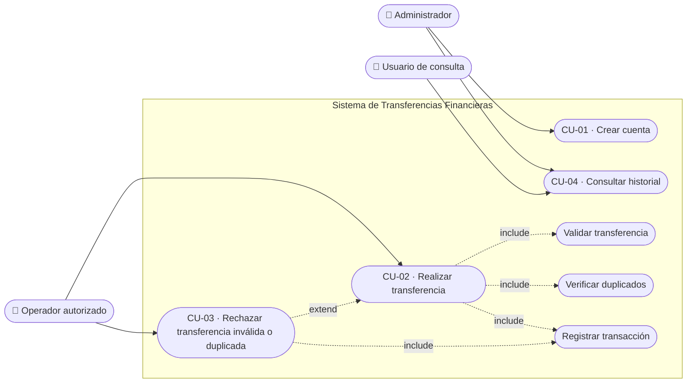

# Casos de Uso

> **Responsable:** Astrid
> **Tarea:** T-03
> **Estado:** ✅ Completado
> **Depende de:** T-01

---

## 1. Propósito

Los casos de uso describen cómo interactúan los usuarios con el sistema para alcanzar un objetivo concreto. Permiten visualizar qué podrá hacer cada rol y qué respuesta recibirá ante situaciones normales, alternas o de error. Cada caso de uso está ligado a los requerimientos funcionales que ejercita, sosteniendo la trazabilidad `Requerimiento → Caso de uso → Diseño → Prueba`.

---

## 2. Actores del sistema

| Actor | Descripción | Permisos principales |
|-------|-------------|----------------------|
| **Administrador** | Registra cuentas y consulta la información que sus permisos le permitan. | Crear y consultar cuentas. |
| **Operador autorizado** | Solicita o procesa transferencias conforme a los permisos establecidos. | Solicitar y procesar transferencias. |
| **Usuario de consulta** | Revisa el historial de operaciones que tiene permitido consultar. | Consultar historial. |
| **Sistema** | Actor de apoyo que ejecuta validaciones automáticas, actualiza saldos y registra resultados. | Validar, procesar, registrar. |

> Estos actores son una propuesta inicial; sus responsabilidades definitivas deberán acordarse con la institución.

---

## 3. Diagrama de casos de uso

> **Nota de modelado:** las validaciones (existencia de cuentas, fondos, duplicados) y el registro de transacciones **no son casos de uso independientes**, sino pasos internos incluidos (`<<include>>`) en CU-02 y CU-03. CU-03 es una extensión (`<<extend>>`) de CU-02 que agrupa los escenarios de rechazo. Modelar las validaciones como casos de uso con actor "Sistema" sería un antipatrón UML; por eso se representan como inclusiones.

> **Versión UML formal:** el mismo diagrama en notación UML estándar (actores, óvalos, límite del sistema, relaciones include/extend) está disponible en `diagrama-casos-de-uso.drawio`, editable en [draw.io / diagrams.net](https://app.diagrams.net).

---

## 4. Listado de casos de uso

| ID | Caso de uso | Actor principal | RF relacionados |
|-------|-------------|-----------------|-----------------|
| **CU-01** | Crear una cuenta | Administrador | RF-01, RF-02 |
| **CU-02** | Realizar una transferencia | Operador autorizado | RF-03, RF-04, RF-06, RF-07 |
| **CU-03** | Rechazar transferencia inválida o duplicada | Operador autorizado | RF-04, RF-05, RF-09 |
| **CU-04** | Consultar el historial de transacciones | Usuario de consulta | RF-08 |

---

## 5. Descripción expandida de los casos de uso

### CU-01 · Crear una cuenta
- **Actor:** Administrador
- **Objetivo:** Registrar una nueva cuenta en el sistema.
- **Precondiciones:** El administrador está autenticado y autorizado.
- **Postcondiciones:** La cuenta queda registrada con un identificador único.

**Flujo principal**
1. El administrador solicita crear una cuenta.
2. El sistema verifica los datos obligatorios y que no exista una cuenta con el mismo identificador.
3. Si el identificador lo genera el sistema, este asigna uno único.
4. La cuenta se registra y el sistema confirma su creación.

**Flujo de error — identificador duplicado**
- En el paso 2, si ya existe una cuenta con el mismo identificador, la operación se rechaza y la cuenta original permanece sin cambios.

**Criterio de aceptación**
- No pueden existir dos cuentas con el mismo identificador. Una cuenta solo se confirma como creada cuando el registro se completa correctamente.

---

### CU-02 · Realizar una transferencia
- **Actor:** Operador autorizado
- **Objetivo:** Mover fondos entre dos cuentas.
- **Precondiciones:** Operador autenticado; cuentas origen y destino existentes y habilitadas.
- **Postcondiciones:** Saldos actualizados y transacción registrada con referencia única.

**Flujo principal**
1. El operador ingresa cuenta de origen, cuenta de destino y monto.
2. El sistema verifica que ambas cuentas existan, estén habilitadas y sean distintas, y que el monto sea válido (> 0).
3. El sistema comprueba que la cuenta de origen disponga de fondos suficientes.
4. El sistema verifica que la solicitud no sea un duplicado (por su referencia única).
5. El sistema descuenta los fondos del origen y los acredita en el destino como **una única operación atómica**.
6. El sistema registra la transacción con su referencia única y confirma el resultado al operador.

**Flujo alterno — fondos insuficientes**
- En el paso 3, si no hay fondos suficientes, el sistema rechaza la operación, conserva los saldos originales y deriva a CU-03.

**Flujo de error — fallo durante el proceso**
- Si ocurre un error entre el débito y el crédito (paso 5), el sistema revierte el débito (*rollback*) para no dejar una operación parcial, y registra el resultado como rechazado.

**Criterio de aceptación**
- El monto debitado del origen es exactamente igual al acreditado en destino. Si la operación no puede completarse íntegramente, ningún saldo se modifica.

---

### CU-03 · Rechazar una transferencia inválida o duplicada
- **Actor:** Operador autorizado
- **Objetivo:** Impedir movimientos incorrectos o repetidos.
- **Precondiciones:** Existe una solicitud de transferencia en proceso de validación.
- **Postcondiciones:** La operación queda rechazada y registrada; ningún saldo se modifica.

**Escenarios de rechazo**
- **Fondos insuficientes:** se rechaza y se conservan los saldos originales.
- **Cuenta inexistente o inhabilitada:** se informa que la operación no puede realizarse.
- **Monto inválido:** se rechazan importes ≤ 0 y cualquiera que incumpla las reglas acordadas.
- **Solicitud duplicada:** si se recibe de nuevo la misma referencia de solicitud, el sistema no vuelve a ejecutar la transferencia y devuelve el resultado original o su estado verificable.
- **Error durante el proceso:** se evita confirmar una operación parcial y se verifica su resultado antes de permitir un nuevo intento.

**Criterio de aceptación**
- Ninguna solicitud rechazada modifica los saldos. Reintentar una solicitud ya procesada no genera un segundo débito ni un segundo crédito.

---

### CU-04 · Consultar el historial de transacciones
- **Actor:** Usuario de consulta
- **Objetivo:** Revisar las operaciones realizadas.
- **Precondiciones:** Usuario autenticado con permisos de consulta.
- **Postcondiciones:** Se muestran las operaciones permitidas según los filtros indicados.

**Flujo principal**
1. El usuario accede a la consulta de historial.
2. Indica los criterios disponibles (por ejemplo, cuenta y período).
3. El sistema verifica sus permisos y presenta las operaciones correspondientes.
4. El usuario consulta el detalle y el estado de una transacción.

**Flujo alterno — sin resultados**
- Si no existen transacciones para los criterios indicados, el sistema muestra un resultado vacío informando que no hay operaciones.

**Ejemplo práctico**
- Un responsable de operaciones busca las transferencias de una cuenta del 14 de octubre. Encuentra una transferencia por Q300.00, identifica sus cuentas de origen y destino, consulta su referencia y comprueba que fue completada.

**Criterio de aceptación**
- El historial muestra información coherente con los registros originales, distingue operaciones completadas de rechazadas y respeta los permisos de consulta.

---

## 6. Trazabilidad caso de uso → requerimiento funcional

| Caso de uso | Requerimientos funcionales |
|-------------|----------------------------|
| CU-01 | RF-01, RF-02 |
| CU-02 | RF-03, RF-04, RF-06, RF-07 |
| CU-03 | RF-04, RF-05, RF-09 |
| CU-04 | RF-08 |
