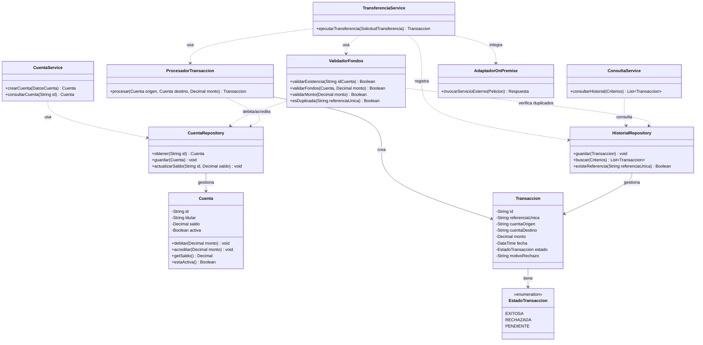

# Diagrama de Clases

> **Responsable:** Wuilli
> **Tarea:** T-08
> **Estado:** ✅ Completado
> **Depende de:** T-06 (Diseño de componentes)

---

## 1. Propósito

Modelar las clases que implementan los componentes definidos en el diseño de componentes (C-01..C-09), con sus atributos, métodos y relaciones. El diseño concentra la modificación de saldos en una única clase (`ProcesadorTransaccion`) para proteger el invariante financiero.

---

## 2. Diagrama de clases

> **Versión editable (draw.io):** `diagrama-clases.drawio`.

---

## 3. Descripción de las clases

| Clase | Componente | Responsabilidad |
|-------|------------|-----------------|
| `Cuenta` | C-07 | Representa una cuenta con saldo e identificador único; sabe debitar y acreditar. |
| `Transaccion` | C-08 | Registra los datos y el resultado de cada operación. |
| `EstadoTransaccion` | — | Enumeración del estado: EXITOSA, RECHAZADA, PENDIENTE. |
| `TransferenciaService` | C-02 | Orquesta la transferencia y controla la idempotencia. |
| `CuentaService` | C-03 | Crea y consulta cuentas. |
| `ConsultaService` | C-04 | Consulta el historial según permisos y filtros. |
| `ValidadorFondos` | C-05 | Valida existencia, monto, fondos y duplicados. |
| `ProcesadorTransaccion` | C-06 | **Única clase que modifica saldos**, siempre de forma atómica. |
| `CuentaRepository` | C-07 | Persiste y recupera cuentas. |
| `HistorialRepository` | C-08 | Persiste y consulta transacciones. |
| `AdaptadorOnPremise` | C-09 | Traduce llamadas hacia sistemas on-premise (API/SOAP sobre VPN). |

---

## 4. Relaciones

| Relación | Tipo |
|----------|------|
| `TransferenciaService` → `ValidadorFondos` | Dependencia |
| `TransferenciaService` → `ProcesadorTransaccion` | Dependencia |
| `TransferenciaService` → `HistorialRepository` | Dependencia |
| `ProcesadorTransaccion` → `Cuenta` | Asociación (modifica saldos) |
| `ProcesadorTransaccion` → `Transaccion` | Creación |
| `Transaccion` → `EstadoTransaccion` | Composición |
| `CuentaRepository` → `Cuenta` | Gestión / persistencia |
| `HistorialRepository` → `Transaccion` | Gestión / persistencia |
