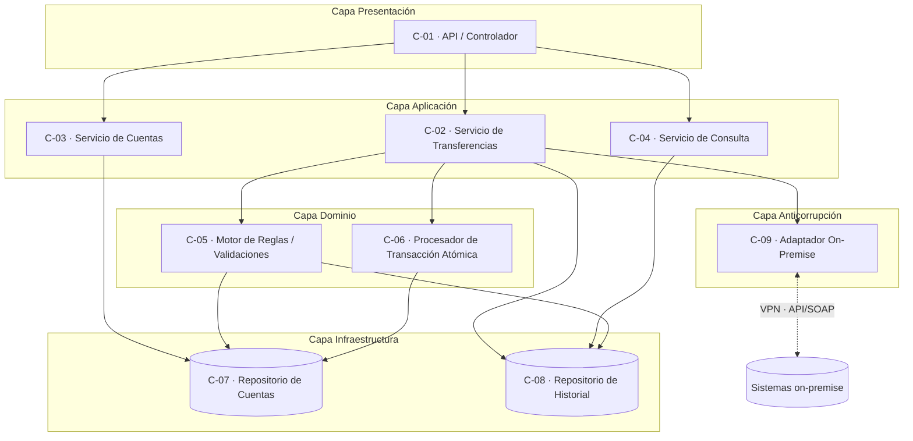

# Diagrama de Componentes

> **Responsable:** Wuilli
> **Tarea:** T-07
> **Estado:** ✅ Completado
> **Depende de:** T-06 (Diseño de componentes)

---

## 1. Propósito

Representar visualmente los componentes del sistema (C-01..C-09), sus interfaces y dependencias, agrupados por la capa arquitectónica a la que pertenecen. Los IDs coinciden con los definidos en el diseño de componentes.

---

## 2. Diagrama de componentes

> **Versión editable (draw.io):** `diagrama-componentes.drawio`.

---

## 3. Interfaces provee / requiere

| Componente | Provee (interfaz) | Requiere (de quién) |
|------------|-------------------|---------------------|
| C-01 API / Controlador | API REST pública | C-02, C-03, C-04 |
| C-02 Servicio de Transferencias | `ejecutarTransferencia()` | C-05, C-06, C-08, C-09 |
| C-03 Servicio de Cuentas | `crearCuenta()`, `consultarCuenta()` | C-07 |
| C-04 Servicio de Consulta | `consultarHistorial()` | C-08 |
| C-05 Motor de Reglas | `validarTransferencia()`, `esDuplicada()` | C-07, C-08 |
| C-06 Procesador Atómico | `procesar()` | C-07 |
| C-07 Repositorio de Cuentas | `obtener()`, `actualizarSaldo()` | Base de datos ACID |
| C-08 Repositorio de Historial | `guardar()`, `buscar()` | Base de datos ACID |
| C-09 Adaptador On-Premise | `invocarServicioExterno()` | Sistemas on-premise (VPN + API/SOAP) |

---

## 4. Notas de diseño

- El flujo crítico (transferencia) atraviesa **C-01 → C-02 → {C-05 validación, C-06 proceso atómico, C-08 registro}**.
- **C-06 es el único que escribe saldos** (vía C-07), siempre dentro de una transacción ACID.
- **C-09 aísla** los detalles de la integración on-premise del resto del sistema (barrera anticorrupción).
