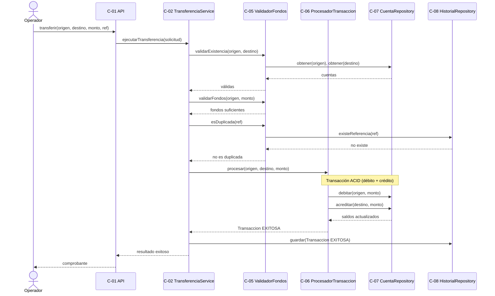
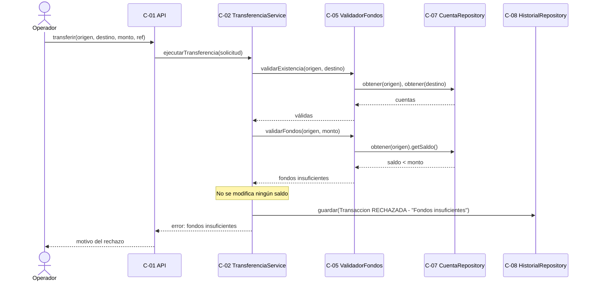
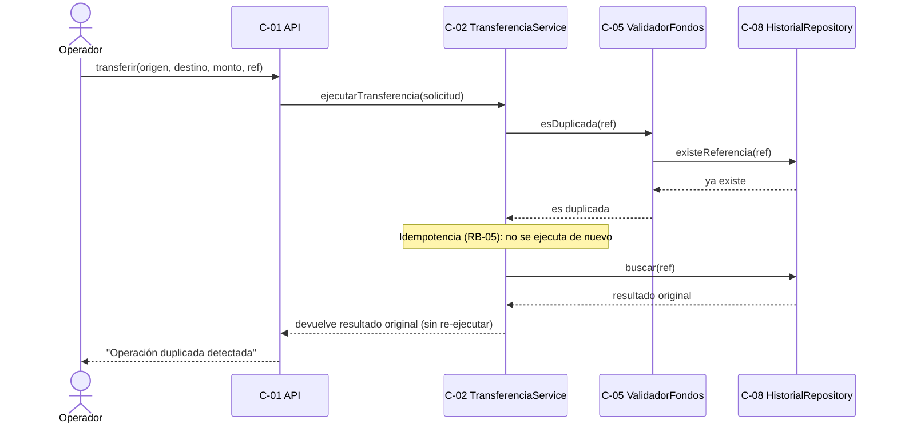

# Diagramas de Secuencia

> **Responsable:** Wuilli
> **Tarea:** T-09
> **Estado:** ✅ Completado
> **Depende de:** T-03 (Casos de uso)

---

## 1. Propósito

Mostrar la interacción temporal entre el actor y los componentes/clases del sistema para los flujos principales de la transferencia. Los participantes corresponden a las clases del diagrama de clases y a los componentes C-01..C-09.

---

## 2. Diagrama 1 — Transferencia exitosa

---

## 3. Diagrama 2 — Transferencia rechazada (fondos insuficientes)

---

## 4. Diagrama 3 — Transferencia duplicada detectada

> **Versión editable (draw.io):** `diagramas-secuencia.drawio` (contiene los tres diagramas en páginas separadas).

---

## 5. Observaciones

- En el flujo exitoso, el débito y el crédito ocurren **dentro de una transacción ACID** gestionada por `ProcesadorTransaccion` (C-06); si cualquiera falla, se revierte todo (RNF-01, RB-07).
- En los flujos de rechazo, **ningún saldo se modifica**: el sistema valida antes de procesar.
- La detección de duplicados aplica **idempotencia por referencia única** (RB-05): una solicitud repetida devuelve el resultado original sin generar un segundo movimiento.
