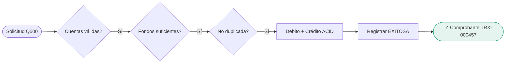
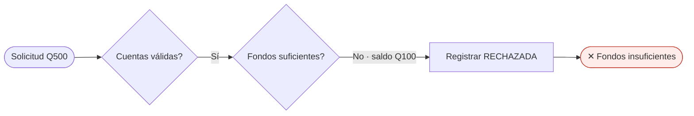
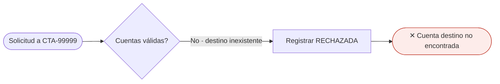
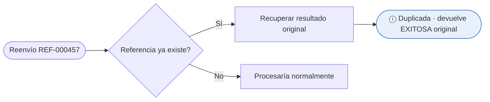
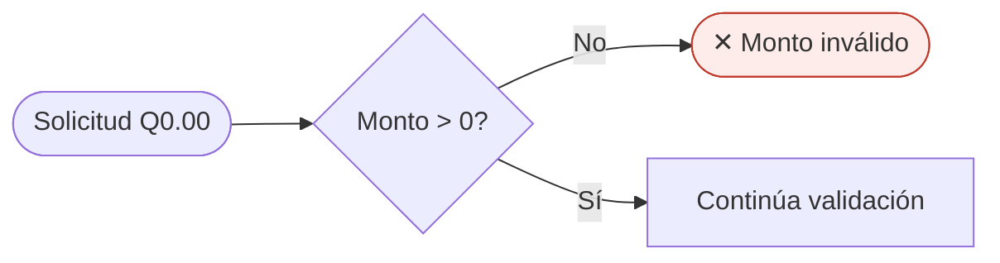
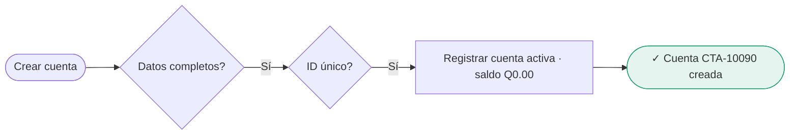
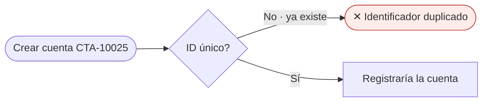
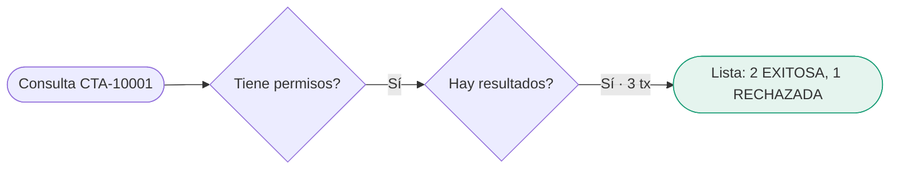
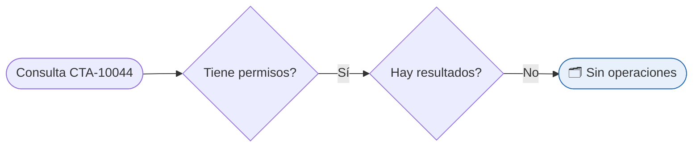

# Casos de Prueba

> **Responsable:** Luis
> **Tarea:** T-13
> **Estado:** ✅ Completado
> **Depende de:** T-03 (Casos de uso)

---

## 1. Propósito

Describir, por cada caso de uso, al menos un escenario **normal**, uno **alterno** y uno de **error**. Cada caso cuenta su **historia** (contexto), define **la prueba** (pasos y resultado) y muestra un **diagrama de flujo** que demuestra el camino funcional de la prueba. Cada caso referencia su caso de uso (CU-xx) y los requerimientos funcionales que verifica (RF-xx).

> **Pantallas de alta fidelidad:** el archivo `casos-de-prueba.html` muestra las 9 pruebas en secuencia vertical, cada una con su pantalla real y su historia. Ábrelo en el navegador y captura cada tarjeta para la presentación.

---

## CP-01 · Transferencia exitosa
**CU-02 · RF-03, RF-04, RF-06, RF-07 · Tipo: normal**

**Historia.** El operador mueve Q500.00 de CTA-10001 a CTA-10025. Ambas cuentas existen y el origen tiene saldo suficiente (Q1,000.00). Es el camino feliz: validar, procesar de forma atómica y entregar comprobante.

**La prueba.** Ingresar datos → validar existencia/fondos/monto/duplicados → ejecutar débito y crédito (ACID) → registrar EXITOSA y emitir comprobante.

**Resultado esperado.** Saldo origen Q500.00; destino +Q500.00; transacción EXITOSA; comprobante con referencia única.

---

## CP-02 · Fondos insuficientes
**CU-02 / CU-03 · RF-04 · Tipo: alterno**

**Historia.** El operador intenta transferir Q500.00 desde CTA-10001, pero solo tiene Q100.00. El sistema se detiene antes de mover dinero y explica el motivo, sin alterar saldos.

**La prueba.** Ingresar datos → validar fondos (saldo < monto) → rechazar y registrar RECHAZADA.

**Resultado esperado.** Operación rechazada; saldos sin cambios; transacción RECHAZADA, motivo "Fondos insuficientes".

---

## CP-03 · Cuenta destino inexistente
**CU-02 / CU-03 · RF-04 · Tipo: error**

**Historia.** El operador escribe por error una cuenta destino que no existe (CTA-99999). El sistema rechaza en la validación, antes de tocar saldos.

**La prueba.** Ingresar destino CTA-99999 → validar existencia (no se encuentra) → rechazar.

**Resultado esperado.** Mensaje "Cuenta destino no encontrada"; sin cambios en saldos; transacción RECHAZADA.

---

## CP-04 · Transferencia duplicada
**CU-02 / CU-03 · RF-05 · Tipo: error**

**Historia.** Por un reintento (doble clic o reenvío de red) llega otra vez una transferencia con la misma referencia única (REF-000457) ya ejecutada. El sistema no mueve el dinero de nuevo: reconoce el duplicado y devuelve el resultado original. Es la garantía de idempotencia.

**La prueba.** Reenviar solicitud con referencia ya procesada → detectar duplicado → devolver resultado original sin re-ejecutar.

**Resultado esperado.** Sin segundo movimiento; se devuelve el resultado original; mensaje "Operación duplicada detectada"; saldos sin cambios.

---

## CP-05 · Monto inválido
**CU-02 / CU-03 · RF-04 · Tipo: error**

**Historia.** El operador intenta transferir Q0.00 o un valor negativo. El sistema lo impide en la validación del formulario, antes de procesar nada.

**La prueba.** Ingresar monto Q0.00/negativo → validar monto → rechazar.

**Resultado esperado.** Operación rechazada antes de procesar; mensaje "Monto inválido"; saldos sin cambios.

---

## CP-06 · Creación de cuenta exitosa
**CU-01 · RF-01 · Tipo: normal**

**Historia.** Un administrador registra una cuenta nueva con datos válidos. No existe otra con el identificador propuesto, así que el sistema la crea con ID único, activa y saldo en cero.

**La prueba.** Ingresar datos → validar obligatorios y unicidad del ID → registrar y confirmar.

**Resultado esperado.** Cuenta con ID único, estado ACTIVA y saldo Q0.00; creación confirmada.

---

## CP-07 · Identificador de cuenta duplicado
**CU-01 · RF-01 · Tipo: error**

**Historia.** El administrador intenta crear una cuenta con un identificador que ya existe (CTA-10025). El sistema rechaza y deja intacta la cuenta original.

**La prueba.** Solicitar crear cuenta con ID CTA-10025 → detectar ID existente → rechazar.

**Resultado esperado.** Operación rechazada; la cuenta original sin cambios; mensaje de identificador duplicado.

---

## CP-08 · Consulta de historial con resultados
**CU-04 · RF-08 · Tipo: normal**

**Historia.** Un usuario con permisos revisa el historial de CTA-10001, que tiene 3 transacciones. El sistema verifica permisos y muestra la lista, distinguiendo exitosas de rechazadas.

**La prueba.** Acceder al historial y filtrar por CTA-10001 → verificar permisos → recuperar y mostrar.

**Resultado esperado.** 3 transacciones con fecha, monto, destino y estado; distingue EXITOSA de RECHAZADA.

---

## CP-09 · Consulta de historial sin resultados
**CU-04 · RF-08 · Tipo: alterno**

**Historia.** El usuario consulta el historial de CTA-10044 en un período sin movimientos. El sistema responde con un estado vacío claro, sin error ni pantalla en blanco.

**La prueba.** Filtrar por CTA-10044 en período sin transacciones → consultar → no hay registros.

**Resultado esperado.** Resultado vacío con mensaje "Sin operaciones"; sin error.

---

## Resumen de cobertura

| Caso de uso | Normal | Alterno | Error |
|-------------|--------|---------|-------|
| CU-01 Crear cuenta | CP-06 | — | CP-07 |
| CU-02 Realizar transferencia | CP-01 | CP-02 | CP-03, CP-04, CP-05 |
| CU-04 Consultar historial | CP-08 | CP-09 | — |

> CU-03 (rechazos) se verifica de forma transversal en CP-02, CP-03, CP-04 y CP-05.
