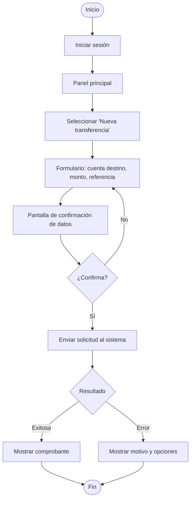
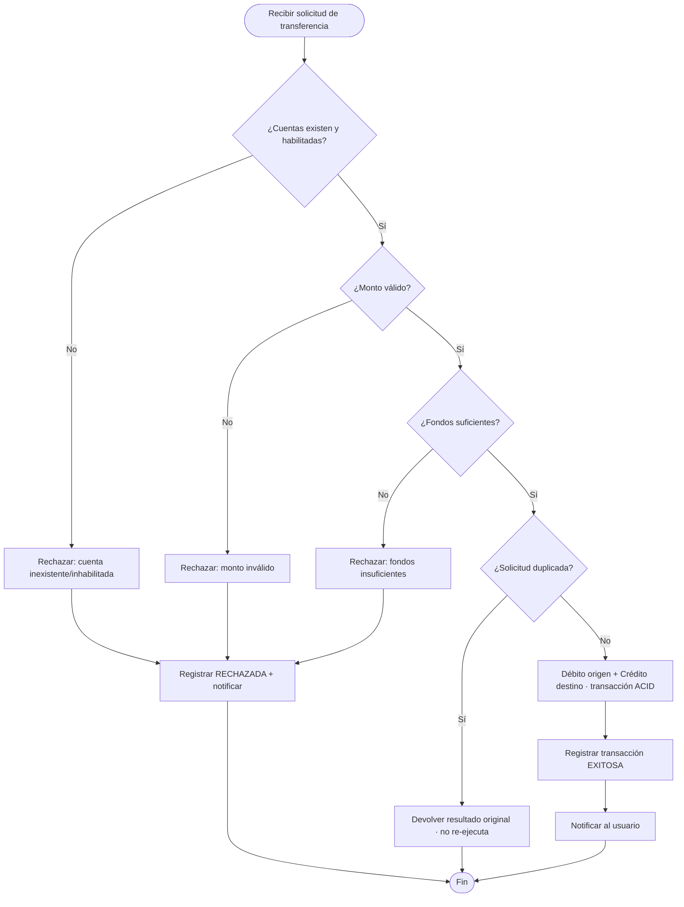
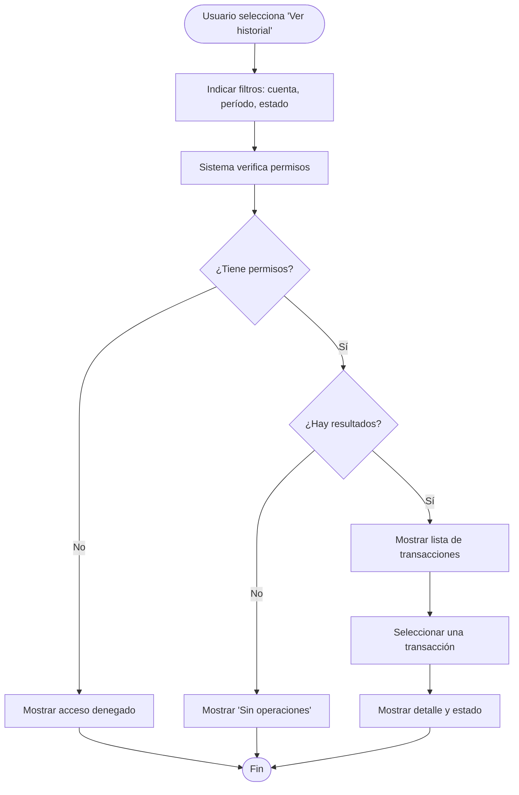
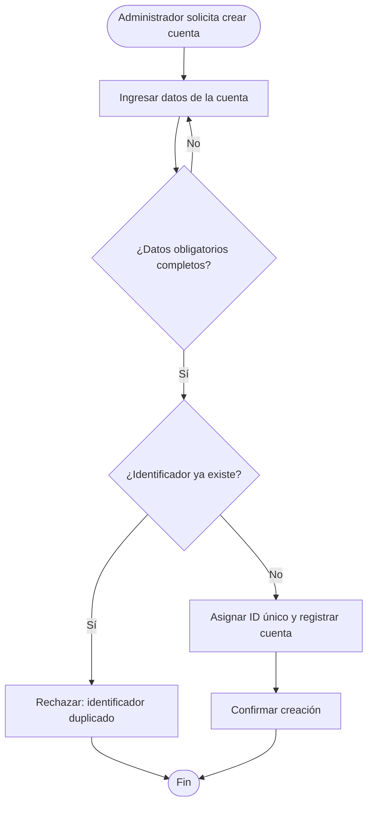

# Flujos UX

> **Responsable:** Josue
> **Tarea:** T-11
> **Estado:** ✅ Completado
> **Depende de:** T-03 (Casos de uso)

---

## 1. Propósito

Describir los flujos de interacción del usuario con el sistema para los casos de uso principales, desde el inicio de la operación hasta su resultado. Cada flujo corresponde a un caso de uso definido en el modelo (CU-01 a CU-04).

---

## 2. Flujo 1 — Inicio de transferencia (perspectiva del usuario · CU-02)

---

## 3. Flujo 2 — Procesamiento en el sistema (perspectiva del sistema · CU-02 / CU-03)

> Los escenarios de rechazo (R1–R4) corresponden a CU-03 y nunca modifican saldos.

---

## 4. Flujo 3 — Consulta de historial (CU-04)

---

## 5. Flujo 4 — Creación de cuenta (CU-01)

---

## 6. Correspondencia flujo → caso de uso

| Flujo | Caso de uso | Pantallas (wireframes) |
|-------|-------------|------------------------|
| Flujo 1 Inicio de transferencia | CU-02 | WF-01, WF-02, WF-03, WF-04, WF-05, WF-06 |
| Flujo 2 Procesamiento | CU-02 / CU-03 | (lógica interna, sin pantalla propia) |
| Flujo 3 Consulta de historial | CU-04 | WF-02, WF-07, WF-08 |
| Flujo 4 Creación de cuenta | CU-01 | (pantalla administrativa) |

> **Versión editable (draw.io):** `flujos-ux.drawio` (los cuatro flujos en páginas separadas).
