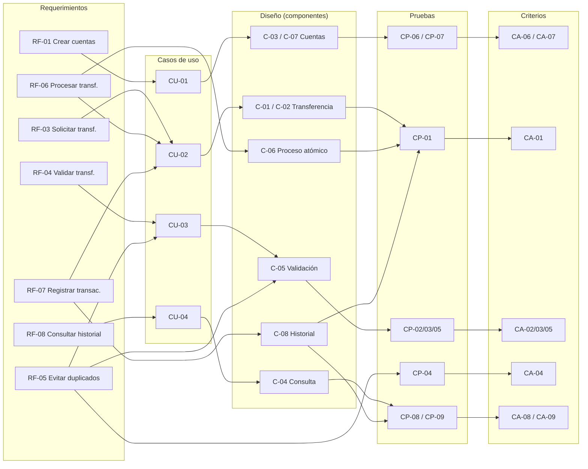
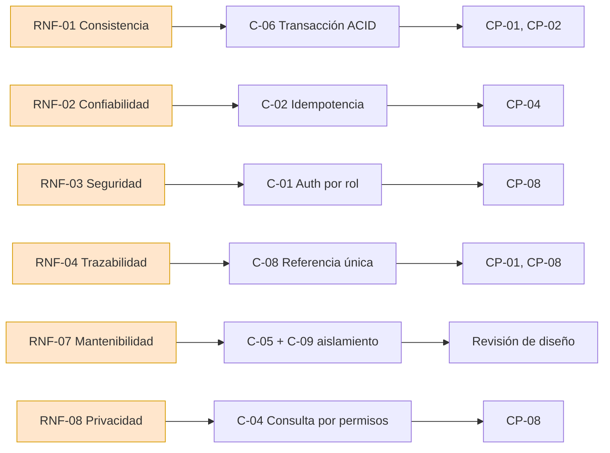
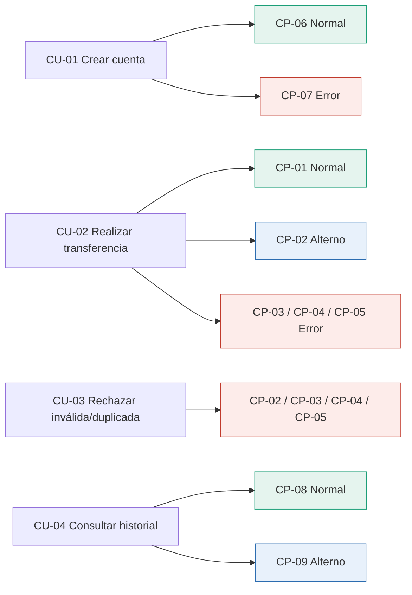

# Matriz de Trazabilidad

> **Responsable:** Luis
> **Tarea:** T-15
> **Estado:** ✅ Completado
> **Depende de:** T-01, T-03, T-06, T-08, T-13, T-14

---

## 1. Propósito

Artefacto integrador del proyecto. Conecta cada requerimiento funcional con su caso de uso, componente, clase de diseño, caso de prueba y criterio de aceptación, cumpliendo la trazabilidad obligatoria:

`Requerimiento → Caso de uso → Diseño → Prueba`

Todos los identificadores corresponden al esquema definitivo del proyecto.

---

## 2. Matriz principal (Requerimiento → Caso de uso → Diseño → Prueba)

| RF | Descripción | Regla(s) negocio | Caso de uso | Componente | Clase de diseño | Caso de prueba | Criterio aceptación |
|------|-------------|------------------|-------------|------------|-----------------|----------------|---------------------|
| **RF-01** | Crear cuentas | RB-01 | CU-01 | C-03, C-07 | `CuentaService`, `Cuenta`, `CuentaRepository` | CP-06, CP-07 | CA-06, CA-07 |
| **RF-02** | Consultar cuentas | RB-03 | CU-01 | C-03, C-07 | `CuentaService`, `CuentaRepository` | CP-06 | CA-06 |
| **RF-03** | Solicitar transferencias | RB-01 | CU-02 | C-01, C-02 | `TransferenciaService` | CP-01 | CA-01 |
| **RF-04** | Validar transferencias | RB-02, RB-03 | CU-02, CU-03 | C-05 | `ValidadorFondos` | CP-02, CP-03, CP-05 | CA-02, CA-03, CA-05 |
| **RF-05** | Evitar duplicados | RB-05 | CU-02, CU-03 | C-05 | `ValidadorFondos`, `HistorialRepository` | CP-04 | CA-04 |
| **RF-06** | Procesar transferencias | RB-04, RB-07 | CU-02 | C-06 | `ProcesadorTransaccion`, `Cuenta` | CP-01 | CA-01 |
| **RF-07** | Registrar transacciones | RB-06 | CU-02, CU-03 | C-08 | `HistorialRepository`, `Transaccion` | CP-01 | CA-01 |
| **RF-08** | Consultar historial | RB-06 | CU-04 | C-04, C-08 | `ConsultaService`, `HistorialRepository` | CP-08, CP-09 | CA-08, CA-09 |
| **RF-09** | Gestionar errores | RB-06, RB-07 | CU-03 | C-02, C-05 | `TransferenciaService`, `ValidadorFondos` | CP-02, CP-03, CP-05 | CA-02, CA-03, CA-05 |

---

## 2.1 Vista gráfica — cadena de trazabilidad por capa

El siguiente diagrama muestra la trazabilidad completa como un flujo de izquierda a derecha: cada requerimiento se conecta con su caso de uso, su diseño (componente/clase), su caso de prueba y su criterio de aceptación. Permite seguir visualmente cualquier cadena de extremo a extremo.

---

## 3. Trazabilidad de requerimientos no funcionales

| RNF | Atributo | Se garantiza en (componente/clase) | Se verifica en |
|-----|----------|------------------------------------|----------------|
| RNF-01 | Consistencia (atomicidad) | C-06 `ProcesadorTransaccion` (transacción ACID) | CP-01, CP-02 |
| RNF-02 | Confiabilidad | C-02 `TransferenciaService` (resultado determinable, idempotencia) | CP-04 |
| RNF-03 | Seguridad | C-01 API (autenticación/autorización por rol) | CP-08 (permisos) |
| RNF-04 | Integridad y trazabilidad | C-08 `HistorialRepository` (referencia única + estado) | CP-01, CP-08 |
| RNF-07 | Mantenibilidad | C-05 dominio aislado + C-09 anticorrupción | (revisión de diseño) |
| RNF-08 | Privacidad | C-04 `ConsultaService` (consulta según permisos) | CP-08 |

### 3.1 Vista gráfica — atributos de calidad

> Cada atributo de calidad se lee: **se exige** (RNF) → **se garantiza en** (componente) → **se verifica en** (prueba).

---

## 4. Cobertura de casos de uso

| Caso de uso | RF cubiertos | Escenarios de prueba | Estado |
|-------------|--------------|----------------------|--------|
| CU-01 Crear cuenta | RF-01, RF-02 | CP-06 (normal), CP-07 (error) | ✅ Cubierto |
| CU-02 Realizar transferencia | RF-03, RF-04, RF-06, RF-07 | CP-01 (normal), CP-02 (alterno), CP-03/CP-04/CP-05 (error) | ✅ Cubierto |
| CU-03 Rechazar inválida/duplicada | RF-04, RF-05, RF-09 | CP-02, CP-03, CP-04, CP-05 | ✅ Cubierto |
| CU-04 Consultar historial | RF-08 | CP-08 (normal), CP-09 (alterno) | ✅ Cubierto |

### 4.1 Vista gráfica — cobertura de pruebas por caso de uso

> Verde = escenario normal · Azul = alterno · Rojo = error. Cada caso de uso tiene cobertura de prueba en los tipos que le aplican.

---

## 5. Verificación de integridad de la trazabilidad

- **Todos los RF (RF-01..RF-09)** tienen al menos un caso de uso, un componente, una clase, un caso de prueba y un criterio de aceptación asociados.
- **Todos los casos de uso (CU-01..CU-04)** están cubiertos por escenarios normal, alterno y/o error.
- **Todos los componentes (C-01..C-09)** aparecen referenciados por al menos un requerimiento.
- **Todas las clases de diseño** del diagrama de clases están ligadas a un componente y a un requerimiento.
- **Todos los casos de prueba (CP-01..CP-09)** tienen su criterio de aceptación verificable correspondiente.

> La cadena `Requerimiento → Caso de uso → Diseño → Prueba` está completa y sin eslabones huérfanos. El proyecto es internamente coherente y defendible de extremo a extremo.
